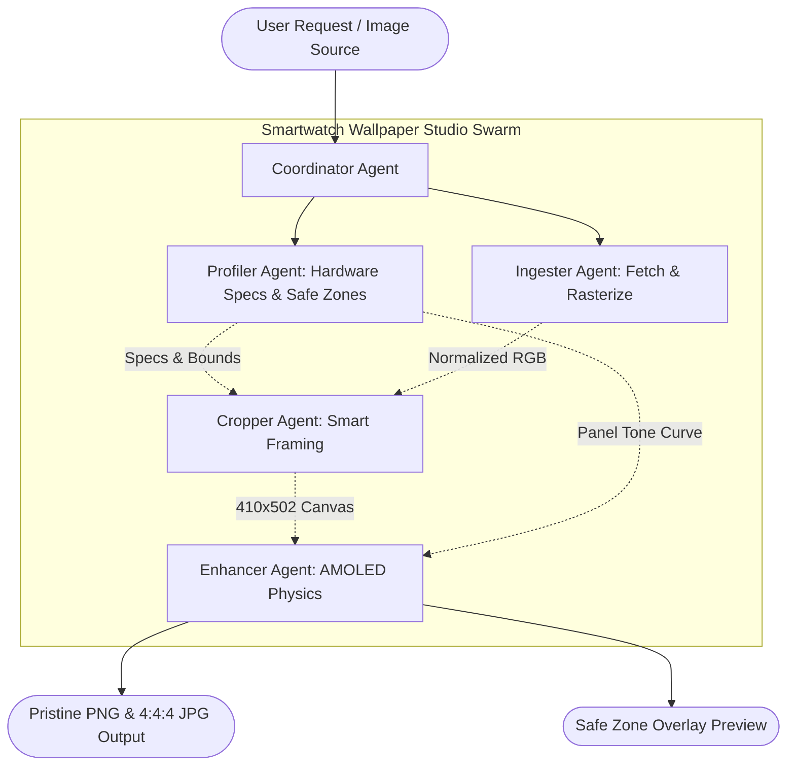

# ⌚ Smartwatch Wallpaper Studio

> **Multi-Agent AI Studio for framing, aspect-ratio adapting, and AMOLED-optimizing custom wallpapers for smartwatches and fitness bands.**

[](https://www.python.org/)
[](LICENSE)
[-orange.svg)]()
[]()

---

## 📖 Background & Problem Statement

Modern smartwatches running **Xiaomi HyperOS / Vela OS** (such as the **Redmi Watch 5 Lite** `N65B` / `M2352W1`, Redmi Watch 5 Active, and Band 9) enforce hardware-level cryptographic signature verification (`.auth` tokens) on compiled `.face` and `.mwz` watchface binaries. Unsigned community binaries fail with `Authorization failed (error code: 3)` or `Device capabilities do not match`.

However, the official companion apps (**Mi Fitness** / **Xiaomi Wear**) include a native **Custom / Album Watchface** engine. This studio provides an automated, multi-agent pipeline that transforms any image (web URLs, Steam Workshop art, wallpapers, photos) into pixel-perfect, color-graded, AMOLED-optimized wallpapers strictly fitted to your smartwatch's exact display specifications and clock safe zones.

---

## 🤖 Multi-Agent Swarm Architecture

The pipeline is modeled after an autonomous multi-agent swarm where specialized roles cooperate to process each image:



### Swarm Roles:
- **`@profiler`**: Hardware lead. Stores screen dimensions, aspect ratios, panel chemistry (AMOLED vs LCD), and UI overlay safe zones for each smartwatch model.
- **`@ingester`**: Universal I/O handler. Safely retrieves images from local paths, web URLs, or Steam Workshop previews with desktop headers and transparency normalization.
- **`@cropper`**: Visual compositor. Applies rule-of-thirds upper vertical bias (`smart` focus) to ensure portraits and character faces are never cropped awkwardly or obscured by the clock.
- **`@enhancer`**: Display physicist. Uses smoothstep Hermite curves to crush deep background shadows to pure `#000000` (turning off OLED pixels for infinite contrast and zero battery consumption), boosts daytime contrast/vibrancy, and applies micro-clarity sharpening.
- **`@coordinator`**: Orchestrator that receives jobs, routes data between agents, and validates output artifacts.

---

## 🚀 Quick Start

### 1. Installation

```bash
git clone https://github.com/War0x/smartwatch-wallpaper-studio.git
cd smartwatch-wallpaper-studio
pip install -r requirements.txt
```

### 2. Basic Usage

Process any local image or web URL for the default **Redmi Watch 5 Lite** (410×502 AMOLED):

```bash
python studio.py -i "path/to/image.png"
```

Process directly from a **web image URL**:

```bash
python studio.py -i "https://example.com/character_art.jpg" -d "rw5_lite" -f smart
```

### 3. Generate Clock Safe-Zone Preview

Generate a diagnostic overlay that shows where the native clock and step counters will appear:

```bash
python studio.py -i "examples/ranni_elden_ring/Ranni_Clean_410x502.png" --safe-zone-preview
```

---

## 📱 Supported Devices Catalog

View all supported devices directly in your terminal:

```bash
python studio.py --list-devices
```

| Key | Device Name | Resolution | Ratio | Display Panel |
| :--- | :--- | :--- | :--- | :--- |
| `rw5_lite` | **Redmi Watch 5 Lite** (Default) | **410 × 502** | 1:1.224 | 1.96" AMOLED (332 PPI) |
| `rw5_active` | **Redmi Watch 5 Active** | **320 × 385** | 1:1.203 | 2.00" LCD |
| `rw4` | **Redmi Watch 4** | **390 × 450** | 1:1.154 | 1.97" AMOLED (302 PPI) |
| `band9` | **Xiaomi Smart Band 8 / 9 / 10** | **192 × 490** | 1:2.552 | 1.62" AMOLED (326 PPI) |
| `band9_pro` | **Xiaomi Smart Band 8 / 9 Pro** | **336 × 480** | 1:1.428 | 1.74" AMOLED (336 PPI) |
| `watch_s4` | **Xiaomi Watch S3 / S4** | **466 × 466** | 1:1.000 | 1.43" AMOLED (326 PPI) |
| `apple_ultra`| **Apple Watch Ultra 1 / 2** | **410 × 502** | 1:1.224 | 1.92" OLED (338 PPI) |
| `galaxy_watch`| **Samsung Galaxy Watch 6 / 7** | **480 × 480** | 1:1.000 | Super AMOLED (327 PPI) |

To inspect detailed hardware metrics and safe zones for any device:

```bash
python studio.py --device-info rw5_lite
```

---

## 🎨 AMOLED Optimization Science

Standard images feature elevated dark-gray levels (`RGB: 12-25`). On an AMOLED screen, this causes the panel's backlight emitters to remain partially active, draining battery and creating visible gray borders around the bezel.

The studio applies a **smoothstep toe roll-off**:

$$\text{scale} = 3t^2 - 2t^3 \quad \text{where} \quad t = \text{clip}\left(\frac{\max(R,G,B) - 14}{10}, 0, 1\right)$$

- **`RGB <= 14`**: Crushed to pure `#000000` (pixels switch off completely).
- **`14 < RGB < 24`**: Smoothly rolled off to prevent harsh color banding or contour halos.
- **`RGB >= 24`**: Full original dynamic range with subtle vibrancy and micro-sharpening applied.

---

## 📲 How to Install on Redmi Watch 5 Lite

1. Process your image using `studio.py`. It will generate both a `.png` and `.jpg` in the output folder.
2. Send the resulting `.jpg` (or `.png`) to your phone (via Telegram, Quick Share, Google Drive, or USB).
3. Open the official **Mi Fitness** app on your phone:
   - Go to **Dispositivo (Device)** -> **Esferas del reloj (Watchfaces)**.
   - Select **Personalizadas / Álbum (Custom / Album)**.
   - Tap the `+` button to add a background photo.
   - Pick the generated image from your gallery.
   - Choose your preferred clock style and text color (white or cyan looks stunning against AMOLED blacks).
   - Tap **Aplicar (Apply)**.
4. Enjoy your custom, razor-sharp watchface with zero signature errors!

---

## 📂 Repository Structure

```
smartwatch-wallpaper-studio/
├── studio.py                # Main CLI entrypoint
├── requirements.txt         # Dependencies (Pillow, numpy, requests)
├── core/
│   ├── __init__.py          # Package interface
│   ├── profiles.json        # Hardware specifications database
│   ├── profiles.py          # Device profile parser & specs formatter
│   ├── ingester.py          # Universal image loader
│   ├── cropper.py           # Smart framing & Lanczos resizer
│   └── enhancer.py          # AMOLED black crush & clarity tuner
├── agents/
│   ├── swarm_config.json    # Swarm roles & pipeline schema
│   ├── profiler.md          # Profiler agent documentation
│   ├── ingester.md          # Ingester agent documentation
│   ├── cropper.md           # Cropper agent documentation
│   └── enhancer.md          # Enhancer agent documentation
└── examples/
    └── ranni_elden_ring/    # Sample Elden Ring wallpaper (410x502)
```

---

## 📄 License

MIT License. Free for personal and commercial customization.
